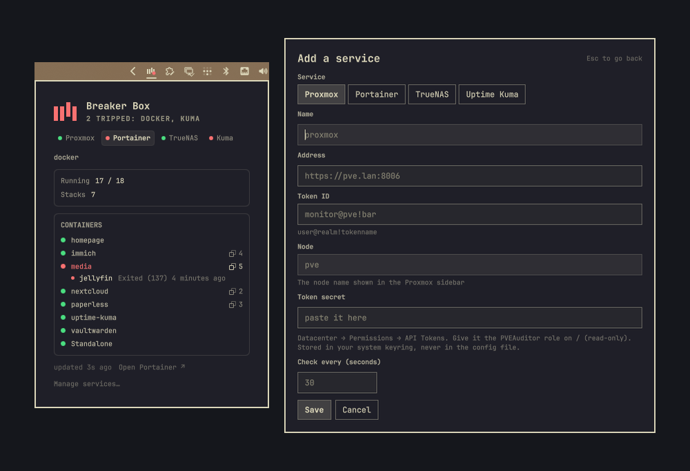
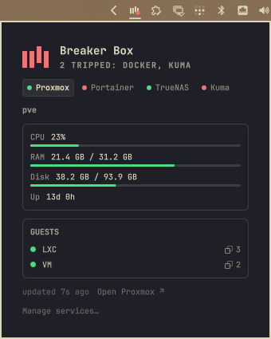
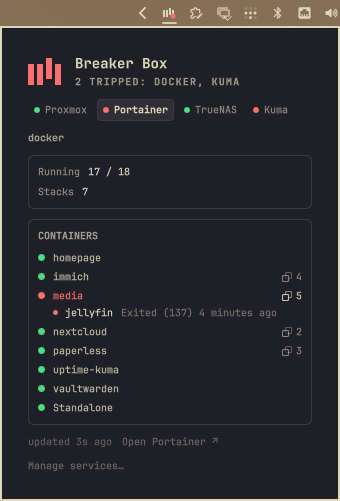
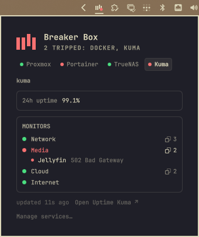

<p align="center">
  <picture>
    <source media="(prefers-color-scheme: dark)" srcset="assets/icon-light.svg">
    
  </picture>
</p>

# Breaker Box

**Your homelab's breaker panel, in the Omarchy bar.** One quiet dot. When
something trips, click it and the panel opens on exactly what broke:
which container, in which stack, on which box.

It reads Proxmox, Portainer, TrueNAS and Uptime Kuma through their own
APIs, so it knows *what* is down, not just that a port stopped answering.

This project was written entirely by Claude, an AI model made by Anthropic,
at the direction of Absolute-Candor, who specified the behavior, reviewed
the result, and made every product and security decision described below.



<p>
  
  
  
</p>

*Screenshots use a made-up lab (see `tests/demo/`), not anyone's real setup.*

## What it does

- **One dot.** Green, amber or red: the worst state across everything you
  configured. Hover for a one-line summary; right-click to refresh now.
- **One panel.** A tab per service, a sub-tab per instance, then:
  headline stats, active alerts, and groups (Proxmox pools, compose stacks,
  TrueNAS apps). Healthy groups collapse to a count. A group with anything
  down is always open.
- **Doesn't flap.** An instance only turns red after `failThreshold` failed
  polls in a row (default 2; a failing instance is retried within 15s). A
  temporary failure keeps the last good data on screen; an outage shows it
  dimmed with "last seen 3m ago".
- **Status only.** It never tries to replace a service's own UI.

Supported now: **Proxmox VE**, **Portainer**, **TrueNAS SCALE** and
**Uptime Kuma**. Adding another is one JS file; see
[docs/ADAPTERS.md](docs/ADAPTERS.md).

## Built for small labs

This is for people getting their feet wet: one Proxmox box, a Docker
host, maybe a NAS, often on cheap or finicky hardware, and always
tinkering, so something's always a bit broken. It answers one question:
*what did I just break?*

It is deliberately not for big labs, and it says so instead of stretching
to fit:

- **At most 4 different services**, one tab each. A second Proxmox doesn't
  add a tab; it appears inside the Proxmox tab, with its own small tabs.
- **At most 3 of each service** (one Uptime Kuma). The setup dialog stops
  you at the limit and suggests a full dashboard such as Homarr or Uptime
  Kuma, which will serve a bigger lab better.
- **Groups, not lists.** Containers roll up into their compose stacks,
  guests into their Proxmox pools. A stack is one row, with a small badge
  showing how many it holds.
- **At most 12 rows per service.** Past that you get "+N more in
  Portainer", which opens Portainer. Anything broken is always moved into
  the visible rows, never hidden behind the "+N".
- **A broken group lists at most 5 broken items** when it opens itself.

## Install

```sh
omarchy plugin add https://github.com/absoluteKander/breakerbox.git --enable
```

### Dependencies

Everything it uses already comes with Omarchy:

| tool | used for |
|---|---|
| `curl` | talking to Proxmox, Portainer and Uptime Kuma |
| `python3` | talking to TrueNAS's WebSocket API (`bin/wsrpc.py`, standard library only) |
| `secret-tool` (libsecret) | storing and reading API keys in your keyring |
| `openssl` | showing a self-signed certificate's fingerprint, only when you ask to pin one |
| `xdg-open` | the "Open ↗" links |

It runs no installer, needs no root, adds no services, and writes only
its own config file (`~/.config/breakerbox/config.json`) and its own
keyring entries, both only when you save something in the setup dialog.

## Remove

```sh
omarchy plugin remove io.github.absolutekander.breakerbox
```

That removes the plugin. Your settings and keys stay behind, so a
reinstall picks up where you left off. To remove those as well:

```sh
rm -r ~/.config/breakerbox
secret-tool clear service breakerbox ref <name>   # once per service; <name> is the part after keyring: in the config
```

(Or remove each service in the setup dialog first: that deletes its key
for you.)

## Add your services

Click the bar icon, then **Add your first service** (or **Manage
services…** at the bottom of the panel, or press `s` in it). Setup opens
as a dialog in the middle of the screen. It stays open until you press
Esc, Cancel or Save, so you can switch to a browser to copy a key.

For each service you enter a name, its address, any service-specific
fields (each with a hint saying where to find it) and the API key. Press
**Save** and it:

1. checks the connection using the details you entered,
2. stores the key in your system keyring,
3. writes the rest to the config file.

If the check fails you get the reason ("auth rejected", "timed out", …)
and a **Save anyway** button for a server that's just down right now. If
the server uses a self-signed certificate you get **Inspect certificate**
instead. It shows you the certificate's fingerprint to compare against
the server's own settings, and **Trust this certificate** pins it for
that one service.

Edit and Remove are in the same dialog. Removing a service also deletes
its key from the keyring.

The dialog is fully keyboard-driven: Tab between fields, Enter to save,
`a` to add, Esc to go back.

```sh
qs ipc -p "$OMARCHY_PATH/shell" call io.github.absolutekander.breakerbox setup   # open it from a script/keybind
```

### Config file (optional)

Everything the dialog does lands in a plain JSON file, which you can also
edit by hand (it's watched, so changes apply as soon as you save):

```
~/.config/breakerbox/config.json
```

It lives **outside** the plugin folder, so plugin updates never touch it.
See [`config.example.json`](config.example.json).

| field | |
|---|---|
| `type` | `proxmox`, `portainer`, `truenas` or `uptimekuma` |
| `name` | your label; must be unique |
| `url` | base URL, no API path |
| `secret` | a **reference**: `keyring:<ref>` or `pass:<path>` (not for Uptime Kuma) |
| `pin` | optional: `sha256//…` for a self-signed cert |
| `interval` | optional: seconds between polls (min 10) |

Per service: **Proxmox** needs `tokenId` (`user@realm!name`) and `node`;
**Portainer** needs `endpointId`; **TrueNAS** needs `username` (the user
the API key belongs to);
**Uptime Kuma** needs `slug` and no secret.

### TrueNAS

Needs TrueNAS SCALE **25.04 or newer**. TrueNAS removed its REST API in
version 26/27, so the plugin talks to its WebSocket API instead, using a
small standard-library Python helper (`bin/wsrpc.py`) under the same
rules as everything else: the key goes over stdin only, certificates are
checked normally or pinned per instance, and there's a hard timeout. It
logs in with `auth.login_ex`, the method TrueNAS keeps going forward,
which needs the username the key belongs to.

### Uptime Kuma

Uptime Kuma can watch almost anything, which makes it the quickest way to
end up with 40 rows in your bar. So the plugin reads **one status page**,
not all your monitors. Make a status page in Kuma containing only what
you want at a glance, grouped how you like, and give the plugin its name
(the part after `/status/`). Each group on that page becomes one row.
Status pages are public, so no API key is needed. Monitors in maintenance
show grey and never turn anything amber or red.

Problems in the file are shown at the top of the panel, one per entry. A
bad entry is skipped and the rest still load. If the file isn't valid
JSON at all, the dialog won't edit it, so it can't overwrite your work.

## Secrets

Secrets never go in `config.json`. The plugin refuses to load an entry
whose `secret` isn't a `keyring:` or `pass:` reference.

The setup dialog handles the keyring for you. If you edit the file by
hand, there's a helper:

```sh
bin/breakerbox-secret set pve        # prompts, stores in your keyring
bin/breakerbox-secret check pve      # present / missing, never prints it
```

For `pass:`, use `pass insert homelab/truenas` (only the first line is
used). The dialog can edit a `pass:` service, but won't write to `pass`
for you.

How secrets are handled: they're looked up when first needed and again
after a 401/403, kept only in the shell's memory, and passed to curl over
stdin, so they never appear in a process list, a file or a log. Redirects
are never followed, so a secret is never sent to a second host. One
limitation: the shell's JavaScript engine can't wipe strings, so a secret
stays in memory until the shell's garbage collector frees it.

## TLS

Normal CA-signed certs (Let's Encrypt, a reverse proxy) need nothing.

For a **self-signed** cert, the setup dialog offers **Inspect
certificate** when the check fails. From a terminal:

```sh
bin/breakerbox-secret pin https://pve.lan:8006
```

Either way, compare the fingerprint with the one the server shows you
before trusting it. A pinned instance accepts that public key and nothing
else; a changed cert shows as "certificate pin mismatch". There is no
global "skip verification" option.

Don't pin Let's Encrypt certs: they usually get a new key on renewal.

## Scripting

```sh
qs ipc -p "$OMARCHY_PATH/shell" call io.github.absolutekander.breakerbox status    # "ok\tBreaker Box: All quiet"
qs ipc -p "$OMARCHY_PATH/shell" call io.github.absolutekander.breakerbox refresh
```

## Development

```sh
node tests/run.js            # core + adapter tests, no network
node tests/live.js           # one real poll of every configured instance (read-only GETs)
omarchy plugin validate .
```

**Screenshots** come from a fake lab, so no real addresses ever end up in
an image. `tests/demo/mocklab.py` (standard-library Python) pretends to be
Proxmox, Portainer, TrueNAS (including its WebSocket API) and Uptime Kuma
on `127.0.0.1:8787`, with a crashed Jellyfin to show off.
`tests/demo/screenshots.sh` does the whole thing: starts the fake lab,
swaps in `tests/demo/demo-config.json` with dummy keyring entries, takes
and crops every screenshot plus `preview.png`, then puts your own config
back and removes the dummy keys, even if something fails partway.

Layout: `core/Core.js` (pure logic: status, debounce, config validation
and editing, curl argv), `adapters/` (one file per service, including the
labels and hints the setup form shows), `Monitor.qml` (the one singleton:
scheduler, secrets, processes, config writes), `ManageDialog.qml` (the overlay
dialog), and generic views (`Panel`, `InstanceView`, `GroupList`, …).

## License

[MIT](LICENSE) © 2026 Absolute-Candor.
